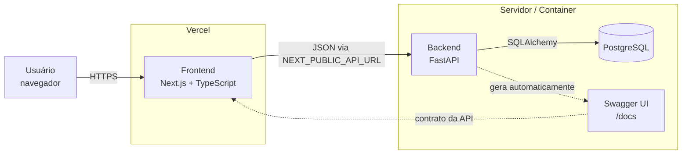
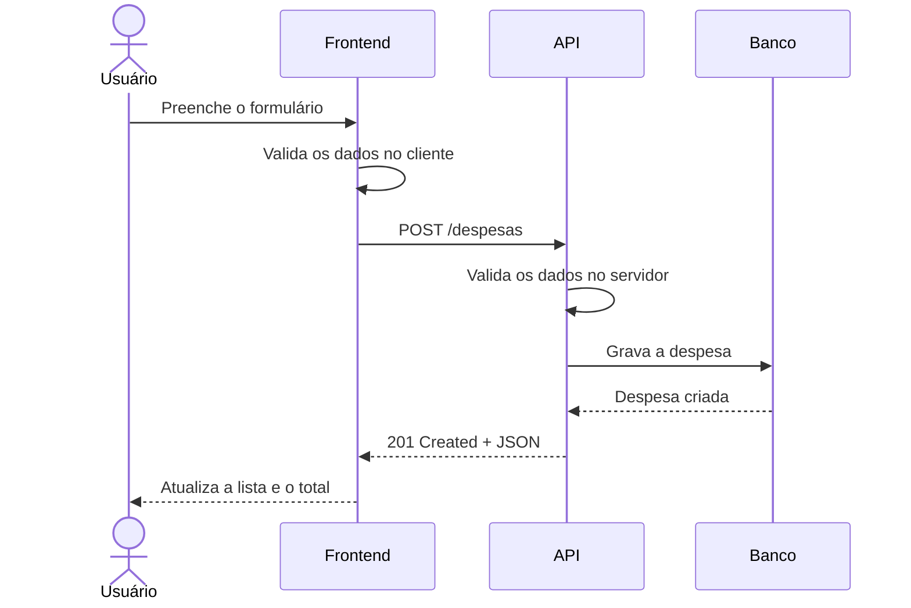
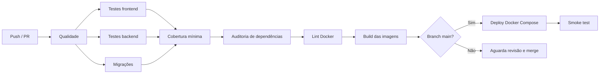

# Sistema de Gestão de Despesas

Aplicação web para controle de despesas pessoais: cadastro, categorização, filtros por período e acompanhamento dos gastos.

Frontend em Next.js (React) com TypeScript, hospedado na Vercel, e backend em Python com FastAPI para a API REST. PostgreSQL é o banco previsto para produção; a configuração local utiliza SQLite por padrão.

## Integrantes

| Integrante | Responsabilidades |
| --- | --- |
| **Marco Di Toro** | UI/UX, Backend e QA |
| **Gabriel Texeira** | Frontend e QA |
| **Paulo Vicente** | DevOps, CI/CD e QA |
| **André Dias Balbino** | Frontend, Backend e QA |
| **João Victor Siécola Souza** | Frontend, Backend e QA |

## Objetivo

Permitir que o usuário registre seus gastos e visualize suas informações financeiras de forma organizada.

Funcionalidades previstas:

* Cadastro, edição, exclusão e listagem de despesas;
* Categorização de gastos;
* Filtros por período e categoria;
* Visualização do total de despesas;
* Exportação das despesas em CSV;
* Dashboard para acompanhamento;
* Interface responsiva.

---

## 📋 Requisitos Funcionais

| Código | Requisito | História | Situação |
| --- | --- | --- | --- |
| RF01 | Permitir cadastrar despesas com valor, descrição, categoria e data. | US01 | Implementado (frontend e API) |
| RF02 | Permitir editar despesas cadastradas. | US03 | API pronta; tela de edição pendente |
| RF03 | Permitir excluir despesas. | US04 | Implementado (frontend e API) |
| RF04 | Listar todas as despesas cadastradas. | US02 | Implementado (frontend e API) |
| RF05 | Permitir categorizar despesas em Alimentação, Transporte, Moradia, Saúde, Educação, Lazer ou Outros. | US01 | Implementado no frontend |
| RF06 | Permitir filtrar despesas por período e categoria. | US05 | Implementado no frontend |
| RF07 | Calcular e apresentar o valor total das despesas e o total por categoria. | US02 | Implementado no frontend |
| RF08 | Disponibilizar um dashboard com gráficos para acompanhamento dos gastos. | US07 | Pendente |
| RF09 | Manter as despesas salvas no servidor por meio da API e do PostgreSQL. | US08 | Pendente: o frontend ainda usa `localStorage` |
| RF10 | Listar as categorias na API pelo endpoint `GET /categorias`. | US08 | Pendente |
| RF11 | Permitir exportar as despesas exibidas, respeitando os filtros aplicados, em um arquivo CSV. | US10 | Implementado no frontend |

## ⚙️ Requisitos Não Funcionais

| Código | Requisito | Situação |
| --- | --- | --- |
| RNF01 | A interface deverá ser responsiva para computadores, tablets e celulares. | Atendido (Tailwind, breakpoints `sm`/`md`/`lg`) |
| RNF02 | O backend deverá utilizar Python com FastAPI. | Atendido |
| RNF03 | O frontend deverá utilizar Next.js com TypeScript. | Atendido |
| RNF04 | O banco de dados de produção deverá ser PostgreSQL. | Parcial: a API lê `DATABASE_URL` e inclui o driver, mas o padrão local e o Docker Compose usam SQLite |
| RNF05 | A API deverá disponibilizar documentação Swagger/OpenAPI. | Atendido (`/docs` e `/openapi.json`) |
| RNF06 | O ambiente deverá poder ser executado com Docker e Docker Compose. | Atendido |
| RNF07 | O sistema deverá possuir testes automatizados com pytest (backend) e Vitest (frontend). | Atendido: 22 testes pytest e 74 Vitest |
| RNF08 | O projeto deverá utilizar GitHub para versionamento, com branches e Pull Requests. | Atendido |
| RNF09 | O pipeline CI/CD deverá utilizar Jenkins para executar verificações automatizadas. | Parcial: pipeline versionado; execução na instância Jenkins pendente |
| RNF10 | Os dados deverão ser validados no frontend e na API: valor maior que zero, data não futura e categoria existente. | Parcial: o frontend valida tudo; a API valida valor e descrição |
| RNF11 | A API deverá seguir o padrão REST com JSON. | Atendido |
| RNF12 | O código deverá possuir pelo menos 80% de cobertura de testes no frontend e no backend. | Atendido: 85,84% de linhas no frontend e 86% no backend; o job `cobertura-minima` exige 80% |
| RNF13 | Toda alteração deverá passar por Pull Request com duas aprovações e pelas verificações do pipeline Jenkins. | Regra do grupo, descrita em [Fluxo de trabalho](#fluxo-de-trabalho) |
| RNF14 | A aplicação deverá iniciar com Docker Compose, sem instalação manual das dependências no host. | Atendido |
| RNF15 | As mudanças no banco deverão ser versionadas com Alembic. | Atendido |
| RNF16 | Os valores deverão ser exibidos em reais (R$). | Atendido |

## 🔄 Metodologia Ágil — Kanban

O grupo utiliza a metodologia Kanban por meio do [GitHub Projects — quadro do projeto](https://github.com/orgs/C14-Inatel-2026-2/projects/10) para organizar e acompanhar as atividades. O quadro permite acompanhar o progresso do desenvolvimento nas seguintes colunas:

| Coluna | Descrição |
| --- | --- |
| **Todo** | Atividades planejadas e ainda não iniciadas. |
| **In Progress** | Atividades em desenvolvimento. |
| **Done** | Atividades concluídas. |

As funcionalidades são organizadas em histórias de usuário, cadastradas como issues com o label `user-story` e organizadas no quadro. Cada história segue o formato “Como… quero… para…”, com critérios de aceite em checklist e um responsável. Tarefas técnicas, como jobs de CI e testes, são issues comuns, identificadas pelos labels `devops`, `test`, `frontend` e `backend`. As alterações no código seguem as regras da seção [Fluxo de trabalho](#fluxo-de-trabalho).

### Histórias de usuário

| História | Responsável | Requisitos | Situação |
| --- | --- | --- | --- |
| [US01 — Cadastrar despesa](https://github.com/C14-Inatel-2026-2/Sistema-de-Gestao-Despesas/issues/26) | André Dias Balbino | RF01, RF05 | Done |
| [US02 — Listar despesas, total e resumo por categoria](https://github.com/C14-Inatel-2026-2/Sistema-de-Gestao-Despesas/issues/27) | Gabriel Gazotti | RF04, RF07 | Done |
| [US03 — Editar despesa](https://github.com/C14-Inatel-2026-2/Sistema-de-Gestao-Despesas/issues/28) | André Dias Balbino | RF02 | Todo |
| [US04 — Excluir despesa](https://github.com/C14-Inatel-2026-2/Sistema-de-Gestao-Despesas/issues/29) | João Victor Siécola Souza | RF03 | Done |
| [US05 — Filtrar despesas por período e categoria](https://github.com/C14-Inatel-2026-2/Sistema-de-Gestao-Despesas/issues/30) | Marco Di Toro | RF06 | Done |
| [US06 — Acessar o sistema online sempre atualizado](https://github.com/C14-Inatel-2026-2/Sistema-de-Gestao-Despesas/issues/31) | Paulo Vicente | RNF09 | In Progress |
| [US07 — Visualizar dashboard de gastos](https://github.com/C14-Inatel-2026-2/Sistema-de-Gestao-Despesas/issues/32) | Marco Di Toro | RF08 | Todo |
| [US08 — Manter as despesas salvas no servidor](https://github.com/C14-Inatel-2026-2/Sistema-de-Gestao-Despesas/issues/33) | João Victor Siécola Souza | RF09, RF10 | Todo |
| [US09 — Consultar a documentação do projeto](https://github.com/C14-Inatel-2026-2/Sistema-de-Gestao-Despesas/issues/35) | Paulo Vicente | — | Done |
| [US10 — Exportar despesas em CSV](https://github.com/C14-Inatel-2026-2/Sistema-de-Gestao-Despesas/issues/45) | João Victor Siécola Souza | RF11 | Done |

Exemplo de história com critérios de aceite (US04):

> **Como** usuário, **quero** excluir uma despesa, **para** remover um registro lançado por engano.
>
> * [x] Cada despesa da lista tem uma ação de excluir.
> * [x] Após excluir, a despesa some da lista e o total é recalculado.
> * [x] A API responde 204 ao excluir e 404 se a despesa não existir.

---

## Tecnologias

### Frontend

* Next.js (React)
* TypeScript
* Tailwind CSS
* shadcn/ui
* Node.js
* pnpm

### Backend

* Python
* FastAPI
* SQLAlchemy
* Alembic
* PostgreSQL
* Swagger / OpenAPI
* Ruff

### Testes

* Vitest
* pytest
* Postman (testes manuais da API, a partir do `/openapi.json`)

### DevOps

* Git e GitHub
* Jenkins (pipeline versionado da Entrega 4)
* Docker e Docker Compose
* Vercel

---

## Arquitetura

A arquitetura prevista divide o sistema em duas aplicações independentes que se comunicam por HTTP/JSON. Nesse fluxo, o frontend acessa os dados pela API, sem acessar diretamente o banco. Atualmente, o frontend mantém as despesas no `localStorage`, enquanto a API possui persistência própria; a integração entre essas partes ainda está pendente. Os diagramas abaixo representam a arquitetura e o fluxo esperados.



### Fluxo de uma requisição

Cadastro de uma despesa, do clique até a tela atualizada:



A validação acontece dos dois lados: no frontend para dar retorno imediato ao usuário, e no backend porque a API pode ser chamada por qualquer cliente.

---

## API e documentação

O FastAPI gera a documentação a partir do próprio código, então ela não desatualiza em relação aos endpoints reais. Quem trabalha no frontend consulta o `/docs` para saber o formato de cada requisição, sem precisar ler o código do backend.

| Rota            | Para que serve                                   |
| --------------- | ------------------------------------------------ |
| `/docs`         | Swagger UI, permite testar os endpoints no navegador |
| `/openapi.json` | Contrato da API em JSON                          |

Endpoints implementados em `backend/src/main.py` e endpoint planejado:

| Método | Rota | Descrição | Situação |
| --- | --- | --- | --- |
| `GET` | `/despesas` | Lista as despesas | Implementado |
| `POST` | `/despesas` | Cadastra uma despesa | Implementado |
| `PUT` | `/despesas/{id}` | Edita uma despesa | Implementado |
| `DELETE` | `/despesas/{id}` | Exclui uma despesa | Implementado |
| `GET` | `/categorias` | Lista as categorias | Planejado |

---

## Estrutura do projeto

```text
Sistema-de-Gestao-Despesas/
│
├── frontend/
│   ├── src/
│   │   ├── app/         # Rotas (App Router)
│   │   ├── components/  # Componentes de UI
│   │   ├── hooks/       # Estado compartilhado
│   │   ├── lib/         # Regras de negócio
│   │   ├── tests/       # Testes Vitest (components, data, lib)
│   │   └── types/       # Tipos do domínio
│   ├── public/
│   ├── Dockerfile
│   └── package.json
│
├── backend/
│   ├── src/
│   ├── tests/
│   ├── alembic/         # Migrações do banco
│   └── requirements.txt
│
├── docker-compose.yml
├── Jenkinsfile
├── .gitignore
└── README.md
```

---

## Testes

| Camada              | Ferramenta               | O que cobre                          |
| ------------------- | ------------------------ | ------------------------------------ |
| Unitário (frontend) | Vitest + Testing Library | Regras de negócio e componentes      |
| Unitário (backend)  | pytest                   | Validações e regras da API           |
| Integração (API)    | pytest + `TestClient`    | Endpoints reais, requisição/resposta |
| Exploratório        | Postman                  | Testes manuais e demonstração        |

Atualmente há 74 testes Vitest e 22 testes pytest, todos passando. Testes ponta a ponta no navegador não fazem parte do escopo atual.

O `TestClient` do FastAPI usa httpx por baixo, então os testes de integração batem nos endpoints de verdade sem precisar subir um servidor. A collection do Postman deve ser importada do `/openapi.json`, para não ser mantida à mão quando a API mudar.

Rodando os testes do frontend:

```bash
cd frontend
pnpm install
pnpm test
```

Rodando o frontend em desenvolvimento:

```bash
cd frontend
pnpm install
pnpm dev
```

Se o comando `pnpm` não for reconhecido no Windows, instale uma vez com:

```bash
npm install -g pnpm
```

Abra `http://localhost:3000`. Na primeira visita o app carrega despesas mock no `localStorage` para facilitar a demonstração (cadastro, filtros, exclusão e totais).

Rodando os testes do backend:

```bash
cd backend
pip install -r requirements.txt
pytest
```

Funcionalidades cobertas pelos testes:

* Validação de valores de despesas;
* Cadastro de despesas (unitário e de componente);
* Listagem, exclusão e estados vazios (componente);
* Cálculo do total de despesas e resumo por categoria (domínio e componente);
* Filtro de despesas por categoria e por período (domínio e componente);
* Exportação das despesas filtradas em CSV;
* Mock inicial.

---

## Pipeline de CI/CD — Entrega 4

O pipeline usa **Jenkins**, sem GitHub Actions. O `Jenkinsfile` coordena dez jobs independentes, definidos em `ci/`:

| Job | Responsável | Resultado |
| --- | --- | --- |
| `despesas/qualidade` | Paulo Vicente | ESLint, TypeScript e Ruff |
| `despesas/testes-frontend` | Paulo Vicente | Vitest, JUnit e cobertura HTML/XML |
| `despesas/testes-backend` | Paulo Vicente | pytest, JUnit e cobertura HTML/XML |
| `despesas/migracoes` | André Dias Balbino | Aplica as migrações Alembic em um banco limpo |
| `despesas/cobertura-minima` | Gabriel Gazotti | Vitest e pytest-cov com mínimo de 80% de cobertura; falha o pipeline abaixo disso |
| `despesas/auditoria` | João Victor Siécola Souza | `pnpm audit` e `pip-audit` sobre as dependências, sem bloquear o pipeline |
| `despesas/lint-docker` | Marco Di Toro | hadolint nos Dockerfiles e validação do `docker-compose.yml` |
| `despesas/build` | Paulo Vicente | Imagens Docker do frontend e backend |
| `despesas/deploy` | Paulo Vicente | Deploy com healthchecks e volume persistente |
| `despesas/smoke-test` | João Victor Siécola Souza | Chamadas HTTP reais ao frontend e à API após o deploy |

Cada integrante é responsável por pelo menos um job.



Falhas ou testes instáveis impedem as próximas etapas. Todos os jobs recebem o mesmo SHA; as imagens são identificadas por esse SHA. O deploy roda apenas na `main`, reutiliza as imagens do build e aguarda frontend e API ficarem saudáveis. Em seguida, o smoke test acessa o frontend, `/health` e `GET /despesas`, e confirma que um `POST /despesas` inválido é recusado com 422; o resultado fica em **Artifacts** (`reports/smoke-test.txt`). Este deploy usa Docker Compose no agente Jenkins; a hospedagem existente na Vercel continua independente.

Em cada execução dos jobs de testes, abra **Test Result** para consultar os resultados e **Cobertura Frontend** ou **Cobertura Backend** para visualizar os arquivos e linhas cobertas. Os relatórios HTML e XML também ficam disponíveis em **Artifacts**, inclusive quando há falha nos testes. A cobertura inclui arquivos da aplicação sem testes. O job `cobertura-minima` exige pelo menos 80% de cobertura de linhas e statements no frontend e no backend; abaixo disso o pipeline falha antes do build.

O roteiro de instalação, execução, evidências e limitações está em [docs/ci-cd.md](docs/ci-cd.md). Para rodar o pipeline na própria máquina, com Docker, use o [Jenkins local](ci/jenkins-local/README.md).

---

## Dependências

| Parte    | Arquivo                            | Observação                                        |
| -------- | ---------------------------------- | ------------------------------------------------- |
| Frontend | `package.json`, `pnpm-lock.yaml`   | Use sempre `pnpm`; o lockfile é dele              |
| Backend  | `requirements.txt`                 | Instalado com `pip install -r requirements.txt`   |

As mudanças no banco são versionadas com Alembic: toda alteração de tabela vira um arquivo de migração commitado junto com o código, e os integrantes atualizam o banco local com um comando.

```bash
alembic upgrade head
```

---

## Fluxo de trabalho

Cada integrante trabalha na própria branch e envia as alterações por Pull Request, que precisa ser aprovado por **dois outros integrantes** antes do merge na `main`. Cada integrante deve fazer no mínimo um commit no projeto.

```bash
git checkout -b feature/nome-da-feature
```

Os commits seguem o padrão Conventional Commits:

```bash
git commit -m "feat: adiciona cadastro de despesas"
git commit -m "fix: corrige cálculo do total"
git commit -m "ci: adiciona pipeline do Jenkins"
git commit -m "docs: atualiza documentação"
```

---

## Requisitos da Entrega Inicial

* [x] Definição do projeto;
* [x] Definição das tecnologias;
* [x] Definição inicial da arquitetura;
* [x] Definição das responsabilidades dos integrantes;
* [x] Criar estrutura inicial de pastas;
* [x] Desenvolver pelo menos uma pequena funcionalidade testável;
* [x] Criar `requirements.txt`;
* [x] Criar `package.json`;
* [x] Cada integrante realizar pelo menos 1 commit;
* [x] Cada alteração ser enviada através de Pull Request;
* [x] Configurar CI/CD inicial.

## Requisitos da Entrega 4

* [x] Pipeline Jenkins com Build, Testes e Deploy;
* [x] Dez jobs independentes;
* [x] Pelo menos um job por integrante;
* [x] Relatórios JUnit e cobertura HTML/XML no frontend e backend;
* [ ] Configurar a instância Jenkins e executar o pipeline completo;
* [ ] Registrar evidências da execução, da cobertura e do deploy.

## Requisitos da Entrega 5

* [x] Documentar os requisitos funcionais RF01 a RF11;
* [x] Documentar os requisitos não funcionais RNF01 a RNF16;
* [x] Organizar o projeto com Kanban no GitHub Projects;
* [x] Cadastrar pelo menos cinco histórias de usuário, com pelo menos uma por integrante (dez histórias, US01 a US10);
* [x] Descrever título, história, critérios de aceite e responsável em cada história;
* [x] Manter as issues organizadas no quadro Kanban.

## Status

Em desenvolvimento. O frontend está publicado na Vercel, permite exportar as despesas filtradas em CSV, e a API possui CRUD de despesas. Falta integrar o frontend à API (US08), criar a tela de edição (US03) e o dashboard (US07), além de executar o pipeline na instância Jenkins e registrar as evidências (US06).
