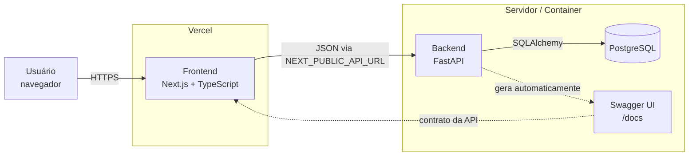
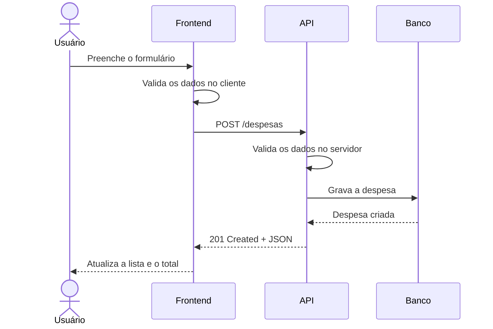
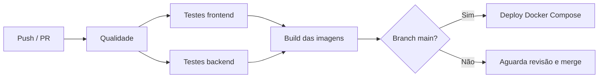

# Sistema de Gestão de Despesas

Aplicação web para controle de despesas pessoais: cadastro, categorização, filtros por período e acompanhamento dos gastos.

Frontend em Next.js (React) com TypeScript, hospedado na Vercel, e backend em Python com FastAPI para a API REST. PostgreSQL é o banco previsto para produção; a configuração local utiliza SQLite por padrão.

## Integrantes

| Integrante | Responsabilidades |
| --- | --- |
| **Marco Di Toro** | UI/UX, Backend e QA |
| **Gabriel Texeira** | Frontend e QA |
| **Paulo Vicente** | DevOps, CI/CD e QA |
| **André Dias Balbino** | Frontend, Backend e QA |
| **João Victor Siécola Souza** | Frontend, Backend e QA |

## Objetivo

Permitir que o usuário registre seus gastos e visualize suas informações financeiras de forma organizada.

Funcionalidades previstas:

* Cadastro, edição, exclusão e listagem de despesas;
* Categorização de gastos;
* Filtros por período e categoria;
* Visualização do total de despesas;
* Dashboard para acompanhamento;
* Interface responsiva.

---

## 📋 Requisitos Funcionais

Os requisitos a seguir definem o escopo esperado, sem indicar conclusão da implementação.

| Código | Requisito |
| --- | --- |
| RF01 | Permitir cadastrar despesas com valor, descrição, categoria e data. |
| RF02 | Permitir editar despesas cadastradas. |
| RF03 | Permitir excluir despesas. |
| RF04 | Listar todas as despesas cadastradas. |
| RF05 | Permitir categorizar despesas. |
| RF06 | Permitir filtrar despesas por período e categoria. |
| RF07 | Calcular e apresentar o valor total das despesas. |
| RF08 | Disponibilizar um dashboard para acompanhamento dos gastos. |

## ⚙️ Requisitos Não Funcionais

| Código | Requisito |
| --- | --- |
| RNF01 | A interface deverá ser responsiva para computadores, tablets e celulares. |
| RNF02 | O backend deverá utilizar Python com FastAPI. |
| RNF03 | O frontend deverá utilizar Next.js com TypeScript. |
| RNF04 | O banco de dados deverá utilizar PostgreSQL. |
| RNF05 | A API deverá disponibilizar documentação Swagger/OpenAPI. |
| RNF06 | O ambiente de desenvolvimento deverá utilizar Docker e Docker Compose. |
| RNF07 | O sistema deverá possuir testes automatizados utilizando pytest e Playwright. |
| RNF08 | O projeto deverá utilizar GitHub para versionamento, com branches e Pull Requests. |
| RNF09 | O pipeline CI/CD deverá utilizar GitHub Actions para executar verificações automatizadas. |

Esses requisitos representam o estado esperado para a Entrega 5. O RNF04 depende da configuração do PostgreSQL, pois o ambiente local e o backend no Docker Compose utilizam SQLite por padrão. Há testes pytest e Vitest no repositório, mas não foi identificada configuração de testes Playwright. O RNF09 permanece pendente: a configuração de CI/CD versionada utiliza Jenkins, conforme a seção da Entrega 4; não há workflows do GitHub Actions no repositório.

## 🔄 Metodologia Ágil — Kanban

O grupo utiliza a metodologia Kanban por meio do GitHub Projects para organizar e acompanhar as atividades. O quadro permite acompanhar o progresso do desenvolvimento nas seguintes colunas:

| Coluna | Descrição |
| --- | --- |
| **Todo** | Atividades planejadas e ainda não iniciadas. |
| **In Progress** | Atividades em desenvolvimento. |
| **Done** | Atividades concluídas. |

As funcionalidades são organizadas em histórias de usuário, cadastradas como issues e organizadas no GitHub Projects. Cada história deve conter título, descrição, critérios de aceite e responsável. Cada integrante deve criar pelo menos uma história de usuário, e o projeto deve possuir pelo menos cinco histórias.

A equipe utiliza branches e Pull Requests para organizar as alterações no código, seguindo as regras da seção “Fluxo de trabalho”. A criação das issues, a participação de cada integrante e a organização do quadro devem ser comprovadas no GitHub; esta documentação não atesta a conclusão dessas atividades.

---

## Tecnologias

### Frontend

* Next.js (React)
* TypeScript
* Tailwind CSS
* shadcn/ui
* Node.js
* pnpm

### Backend

* Python
* FastAPI
* SQLAlchemy
* Alembic
* PostgreSQL
* Swagger / OpenAPI
* Ruff

### Testes

* Vitest
* pytest
* Playwright (previsto; sem configuração identificada no repositório)
* Postman (previsto para testes manuais)

### DevOps

* Git e GitHub
* Jenkins (configuração versionada da Entrega 4)
* GitHub Actions (requisito da Entrega 5; implementação pendente)
* Docker e Docker Compose
* Vercel

---

## Arquitetura

A arquitetura prevista divide o sistema em duas aplicações independentes que se comunicam por HTTP/JSON. Nesse fluxo, o frontend acessa os dados pela API, sem acessar diretamente o banco. Atualmente, o frontend mantém as despesas no `localStorage`, enquanto a API possui persistência própria; a integração entre essas partes ainda está pendente. Os diagramas abaixo representam a arquitetura e o fluxo esperados.



### Fluxo de uma requisição

Cadastro de uma despesa, do clique até a tela atualizada:



A validação acontece dos dois lados: no frontend para dar retorno imediato ao usuário, e no backend porque a API pode ser chamada por qualquer cliente.

---

## API e documentação

O FastAPI gera a documentação a partir do próprio código, então ela não desatualiza em relação aos endpoints reais. Quem trabalha no frontend consulta o `/docs` para saber o formato de cada requisição, sem precisar ler o código do backend.

| Rota            | Para que serve                                   |
| --------------- | ------------------------------------------------ |
| `/docs`         | Swagger UI, permite testar os endpoints no navegador |
| `/openapi.json` | Contrato da API em JSON                          |

Endpoints implementados em `backend/src/main.py` e endpoint planejado:

| Método | Rota | Descrição | Situação |
| --- | --- | --- | --- |
| `GET` | `/despesas` | Lista as despesas | Implementado |
| `POST` | `/despesas` | Cadastra uma despesa | Implementado |
| `PUT` | `/despesas/{id}` | Edita uma despesa | Implementado |
| `DELETE` | `/despesas/{id}` | Exclui uma despesa | Implementado |
| `GET` | `/categorias` | Lista as categorias | Planejado |

---

## Estrutura do projeto

```text
Sistema-de-Gestao-Despesas/
│
├── frontend/
│   ├── src/
│   │   ├── app/         # Rotas (App Router)
│   │   ├── components/  # Componentes de UI
│   │   ├── hooks/       # Estado compartilhado
│   │   ├── lib/         # Regras de negócio
│   │   ├── tests/       # Testes Vitest (components, data, lib)
│   │   └── types/       # Tipos do domínio
│   ├── public/
│   ├── Dockerfile
│   └── package.json
│
├── backend/
│   ├── src/
│   ├── tests/
│   ├── alembic/         # Migrações do banco
│   └── requirements.txt
│
├── docker-compose.yml
├── Jenkinsfile
├── .gitignore
└── README.md
```

---

## Testes

| Camada              | Ferramenta               | O que cobre                          |
| ------------------- | ------------------------ | ------------------------------------ |
| Unitário (frontend) | Vitest + Testing Library | Regras de negócio e componentes      |
| Unitário (backend)  | pytest                   | Validações e regras da API           |
| Integração (API)    | pytest + `TestClient`    | Endpoints reais, requisição/resposta |
| Ponta a ponta       | Playwright               | Fluxos completos no navegador        |
| Exploratório        | Postman                  | Testes manuais e demonstração        |

As linhas de Playwright e Postman representam o escopo previsto, sem evidência de execução no repositório. A existência dos testes Vitest e pytest também não comprova sua execução bem-sucedida.

O `TestClient` do FastAPI usa httpx por baixo, então os testes de integração batem nos endpoints de verdade sem precisar subir um servidor. A collection do Postman deve ser importada do `/openapi.json`, para não ser mantida à mão quando a API mudar.

Rodando os testes do frontend:

```bash
cd frontend
pnpm install
pnpm test
```

Rodando o frontend em desenvolvimento:

```bash
cd frontend
pnpm install
pnpm dev
```

Se o comando `pnpm` não for reconhecido no Windows, instale uma vez com:

```bash
npm install -g pnpm
```

Abra `http://localhost:3000`. Na primeira visita o app carrega despesas mock no `localStorage` para facilitar a demonstração (cadastro, filtros, exclusão e totais).

Rodando os testes do backend:

```bash
cd backend
pip install -r requirements.txt
pytest
```

Funcionalidades contempladas nos arquivos de testes existentes (a presença dos testes não comprova aprovação ou cobertura medida):

* Validação de valores de despesas;
* Cadastro de despesas (unitário e de componente);
* Listagem, exclusão e estados vazios (componente);
* Cálculo do total de despesas e resumo por categoria (domínio e componente);
* Filtro de despesas por categoria e por período (domínio e componente);
* Mock inicial.

---

## Pipeline de CI/CD — Entrega 4

O pipeline usa **Jenkins**, sem GitHub Actions. O `Jenkinsfile` coordena cinco jobs independentes, definidos em `ci/`, com Paulo Vicente responsável pelos cinco jobs:

| Job | Responsável | Resultado |
| --- | --- | --- |
| `despesas/qualidade` | Paulo Vicente | ESLint, TypeScript e Ruff |
| `despesas/testes-frontend` | Paulo Vicente | Vitest, JUnit e cobertura HTML/XML |
| `despesas/testes-backend` | Paulo Vicente | pytest, JUnit e cobertura HTML/XML |
| `despesas/build` | Paulo Vicente | Imagens Docker do frontend e backend |
| `despesas/deploy` | Paulo Vicente | Deploy com healthchecks e volume persistente |

Os cinco jobs estão atribuídos a Paulo Vicente. Para atender ao requisito de pelo menos um job por integrante, os demais integrantes ainda devem definir e comprovar suas próprias contribuições.



Falhas ou testes instáveis impedem as próximas etapas. Todos os jobs recebem o mesmo SHA; as imagens são identificadas por esse SHA. O deploy roda apenas na `main`, reutiliza as imagens do build e aguarda frontend e API ficarem saudáveis. Este deploy usa Docker Compose no agente Jenkins; a hospedagem existente na Vercel continua independente.

Em cada execução dos jobs de testes, abra **Test Result** para consultar os resultados e **Cobertura Frontend** ou **Cobertura Backend** para visualizar os arquivos e linhas cobertas. Os relatórios HTML e XML também ficam disponíveis em **Artifacts**, inclusive quando há falha nos testes. A cobertura inclui arquivos da aplicação sem testes; não há percentual mínimo imposto nesta entrega.

O roteiro de instalação, execução, evidências e limitações está em [docs/ci-cd.md](docs/ci-cd.md).

---

## Dependências

| Parte    | Arquivo                            | Observação                                        |
| -------- | ---------------------------------- | ------------------------------------------------- |
| Frontend | `package.json`, `pnpm-lock.yaml`   | Use sempre `pnpm`; o lockfile é dele              |
| Backend  | `requirements.txt`                 | Instalado com `pip install -r requirements.txt`   |

As mudanças no banco são versionadas com Alembic: toda alteração de tabela vira um arquivo de migração commitado junto com o código, e os integrantes atualizam o banco local com um comando.

```bash
alembic upgrade head
```

---

## Fluxo de trabalho

Cada integrante trabalha na própria branch e envia as alterações por Pull Request, que precisa ser aprovado por **dois outros integrantes** antes do merge na `main`. Cada integrante deve fazer no mínimo um commit no projeto.

```bash
git checkout -b feature/nome-da-feature
```

Os commits seguem o padrão Conventional Commits:

```bash
git commit -m "feat: adiciona cadastro de despesas"
git commit -m "fix: corrige cálculo do total"
git commit -m "ci: adiciona pipeline do Jenkins"
git commit -m "docs: atualiza documentação"
```

---

## Requisitos da Entrega Inicial

* [x] Definição do projeto;
* [x] Definição das tecnologias;
* [x] Definição inicial da arquitetura;
* [x] Definição das responsabilidades dos integrantes;
* [x] Criar estrutura inicial de pastas;
* [x] Desenvolver pelo menos uma pequena funcionalidade testável;
* [x] Criar `requirements.txt`;
* [x] Criar `package.json`;
* [ ] Cada integrante realizar pelo menos 1 commit;
* [ ] Cada alteração ser enviada através de Pull Request;
* [ ] Pull Requests serem aprovados por outro integrante;
* [x] Configurar CI/CD inicial.

---

## Requisitos da Entrega 4

Os itens marcados abaixo indicam configuração presente no repositório, sem comprovar execução no Jenkins, publicação de relatórios ou deploy bem-sucedido.

* [x] Pipeline Jenkins com Build, Testes e Deploy;
* [x] Cinco jobs independentes;
* [ ] Definir e comprovar pelo menos um job por integrante;
* [x] Relatórios JUnit e cobertura HTML/XML no frontend e backend;
* [ ] Publicação dos relatórios e artefatos no Jenkins (configurada; execução e evidências pendentes);
* [ ] Deploy da `main` com Docker Compose e healthchecks (configurado; execução e evidências pendentes);
* [ ] Configurar a instância Jenkins e executar o pipeline completo;
* [ ] Registrar evidências da execução e das coberturas;
* [ ] Obter duas aprovações no PR;
* [ ] Líder enviar o link do repositório até **17/10/2026 às 23:59**.

## Requisitos da Entrega 5

* [x] Documentar os requisitos funcionais RF01 a RF08;
* [x] Documentar os requisitos não funcionais RNF01 a RNF09;
* [x] Documentar a metodologia Kanban e as colunas do GitHub Projects;
* [ ] Comprovar pelo menos cinco histórias de usuário, com pelo menos uma por integrante;
* [ ] Comprovar título, descrição, critérios de aceite e responsável em cada história;
* [ ] Comprovar a organização das issues no quadro Kanban do GitHub Projects.

## Status

Em desenvolvimento. A configuração da Entrega 4 está versionada; a validação completa no Jenkins e as evidências da execução devem ser concluídas antes do envio.
